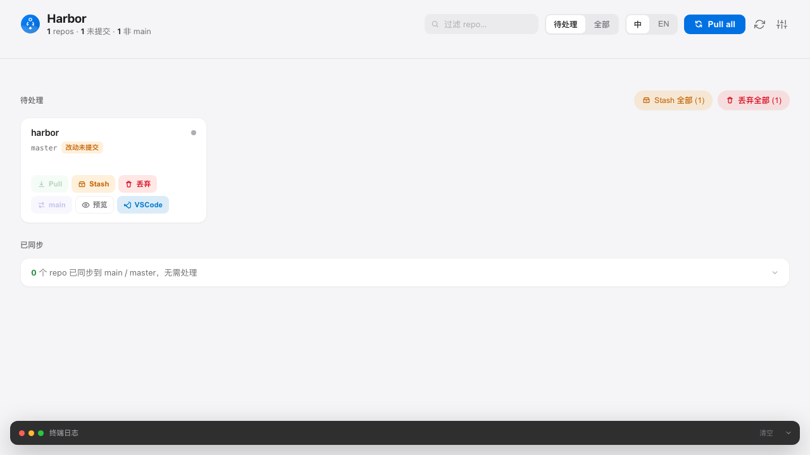

# Harbor

<p align="center">
  
</p>

A local web dashboard for managing multiple git repositories at once.

**Near-zero dependencies** — a pure-Python backend + a self-contained browser UI. No Node.js, no Docker, no build step. The only runtime pip packages are three tiny, optional-conditioned helpers: `tomli` (Python < 3.11 only), `tomli-w`, and `platformdirs`.

<p align="center">
  
</p>

## Why Harbor?

You know the feeling: you've got 20+ git repositories scattered across your laptop — work projects, side projects, open source stuff you cloned to read the code… and every Monday morning you're doing the same dance:

> 🧐 *"Did I push that branch on Friday?"*
> 😅 *"Oh right, this repo is 3 weeks behind."*
> 😤 *"Why did I have uncommitted changes here?"*

Harbor was built for that. It's a little dashboard that shows **all your repos at a glance** — clean, dirty, ahead, behind — and lets you pull, stash, and switch branches in bulk. No more cd-ing around 15 directories before you can start your day.

It's also intentionally simple: one Python package + a self-contained HTML frontend. No build step, no database, no Docker. You install it in 2 seconds and forget about it.

## Features

- **Multi-repo overview** — see every repo's branch, dirty/clean state, and ahead/behind count at a glance
- **Batch Pull** — `git pull --ff-only` across all repos concurrently with real-time SSE progress
- **Stash / Discard / Checkout main** — common operations on individual repos or in bulk
- **Diff preview** — view uncommitted changes before discarding
- **Dark mode** — follows your system preference automatically
- **i18n** — Chinese and English
- **VS Code integration** — open any repo in VS Code with one click
- **Safe** — binds to `127.0.0.1` only; dangerous operations require confirmation

## Quick Start

> **Note**: The PyPI name `harbor` is taken by another project, so Harbor is installed from GitHub.

### Install with pipx (recommended)

[pipx](https://pipx.pypa.io/) gives Harbor its own isolated virtualenv and puts
the `harbor` command on your `PATH`. It sidesteps the
`error: externally-managed-environment` failure (PEP 668) that plain `pip` hits
on Homebrew, Debian, Ubuntu and Fedora Pythons, and it can't break your other
Python packages.

```bash
# 1. Install pipx (skip if `pipx --version` already works)
brew install pipx                    # macOS (Homebrew)
sudo apt install pipx                # Debian / Ubuntu 23.04+
python3 -m pip install --user pipx   # fallback for Pythons that allow user installs

# 2. Put ~/.local/bin (where pipx exposes commands) on your PATH
pipx ensurepath                      # open a new terminal afterwards

# 3. Install Harbor from GitHub
pipx install "git+https://github.com/ginkgohat/harbor.git"

# 4. Verify
harbor --version                     # → harbor 0.1.2.dev9+g...
```

### Install into a virtualenv (alternative)

Use this if you prefer a dedicated environment you manage yourself:

```bash
python3 -m venv ~/.venvs/harbor
~/.venvs/harbor/bin/pip install "git+https://github.com/ginkgohat/harbor.git"
~/.venvs/harbor/bin/harbor --version
```

On Windows the scripts live in `~/.venvs/harbor/Scripts/` instead of `bin/`.

### Update / uninstall

```bash
# pipx install
pipx upgrade harbor        # force a rebuild from the same GitHub URL: pipx reinstall harbor
pipx uninstall harbor

# virtualenv install
~/.venvs/harbor/bin/pip install --upgrade "git+https://github.com/ginkgohat/harbor.git"
rm -rf ~/.venvs/harbor
```

Harbor also has built-in helpers that check how it was installed and print the
command that actually works for your setup:

```bash
harbor update       # upgrade, or tell you the right pipx / venv / PEP 668 command
harbor uninstall    # remove, or tell you the right pipx / PEP 668 command
```

> **Plain `pip` caveat** — `pip install ...` and `pip install --upgrade ...` only
> work inside a virtualenv or with `--user` on a Python that is not PEP 668
> managed. On a Homebrew/Debian/Fedora system Python they fail with
> `error: externally-managed-environment`. The escape hatch
> `pip install --user --break-system-packages "git+..."` works but can break
> OS- or Homebrew-provided Python packages — prefer pipx or a venv.

```bash
# Run — scan the current directory
harbor

# Or scan a specific directory
harbor ~/projects

# Or scan multiple directories
harbor ~/work ~/personal ~/oss
```

### Background mode

```bash
harbor start        # Start Harbor in the background
harbor status       # Check if Harbor is running
harbor stop         # Stop the background Harbor instance
```

Open [http://127.0.0.1:8765](http://127.0.0.1:8765) — or let Harbor open it for you.

### From source (development)

```bash
git clone https://github.com/ginkgohat/harbor.git
cd harbor

# Option A: editable install + dev dependencies
# (`make dev` adds --break-system-packages when the interpreter needs it)
make dev
harbor ~/projects

# Option B: run directly (no install needed)
make run
# or: PYTHONPATH=src python3 -m harbor ~/projects
```

Editable installs are a live checkout and cannot self-update — `harbor update`
will tell you so. Update a dev checkout with `git pull` (then `make dev` if
dependencies changed).

### Makefile

```
make run      # Run Harbor (current directory)
make test     # Run tests
make lint     # Run lint checks
make dev      # Install in development mode
make clean    # Remove build artifacts
```

## Configuration

Settings are resolved in priority order: **CLI flag > environment variable > config file > default**.

| CLI flag | Env var | Config key | Default |
|---|---|---|---|
| `--port` | `HARBOR_PORT` | `port` | `8765` |
| `--min-depth` | `HARBOR_MIN_DEPTH` | `min_depth` | `1` |
| `--max-depth` | `HARBOR_MAX_DEPTH` | `max_depth` | `5` |
| `--config` | `HARBOR_CONFIG` | — | `~/.config/harbor/config.toml` |
| `--no-browser` | — | — | opens browser |

The config file is TOML. Scan roots are stored as an array of tables:

```toml
port = 8765
min_depth = 1
max_depth = 5

[[roots]]
path = "/Users/you/work"
label = "work"

[[roots]]
path = "/Users/you/oss"
label = "oss"
```

Roots passed on the command line (`harbor ~/work ~/oss`) are persisted into
the config file on startup, so Rescan and later runs keep using them. Roots
can also be added/removed from the Settings panel in the UI.

## Troubleshooting

### "Port 8765 is already in use"

If another process is already listening on the default port, you'll see a
friendly error with two options:

```bash
# Use a different port
harbor --port 8766

# Find and stop the process using port 8765
lsof -i :8765
```

### `error: externally-managed-environment` when installing

Your Python is marked as externally managed (PEP 668) by Homebrew, Debian,
Ubuntu, Fedora, etc., so pip refuses to install into it. Use pipx (recommended)
or a virtualenv instead:

```bash
pipx install "git+https://github.com/ginkgohat/harbor.git"
# or
python3 -m venv ~/.venvs/harbor
~/.venvs/harbor/bin/pip install "git+https://github.com/ginkgohat/harbor.git"
```

`--user` alone does not help on these Pythons; `--break-system-packages` does,
at the risk of breaking OS-provided packages. `harbor update` detects this
situation and prints the same options instead of letting pip fail.

### `harbor: command not found`

pipx and `pip install --user` put executables in `~/.local/bin`, which is not
always on `PATH`:

```bash
pipx ensurepath                                    # then open a new terminal
echo 'export PATH="$HOME/.local/bin:$PATH"' >> ~/.zshrc   # non-pipx installs
```

Check what is installed and where — without relying on `PATH`:

```bash
pipx list                       # pipx-managed apps and their executables
which -a harbor                 # every `harbor` on PATH, in resolution order
~/.local/bin/harbor --version   # bypass PATH lookup
```

### Installed or upgraded Harbor, but nothing changed

Install, update and uninstall must target the **same interpreter** that provides
the `harbor` command. A machine can have several Pythons and pips:

```bash
which -a python3 pip harbor     # note the order — the first wins
harbor --version                # what your shell actually runs
python3 -m pip show harbor      # what *this* interpreter has installed
/opt/homebrew/bin/harbor --version   # what another install reports
```

If `pip install --upgrade ...` modifies a different Python than the one behind
`harbor`, the command keeps running the old copy. The reliable fix is pipx (one
isolated environment per app) or the virtualenv route, where you always call
`~/.venvs/harbor/bin/pip` and `~/.venvs/harbor/bin/harbor`. To clean up, remove
Harbor from each interpreter you find (`pipx uninstall harbor`,
`pip uninstall harbor`, ...) until `which -a harbor` is empty.

### `harbor update` says self-update is not available

Editable installs (`make dev`, `pip install -e .`) are a live checkout of the
source tree, so pip has nothing to upgrade. Update the checkout instead:

```bash
git -C /path/to/harbor pull
make dev
```

### Version looks older than expected after installing from GitHub

Harbor's version is derived by `setuptools-scm` from the git tags in the clone
pip builds. If tags were never pushed, GitHub builds a lower version than your
local checkout — for example local `0.1.2.dev9` but `0.1.1.dev15` when installing
from GitHub, because tag `v0.1.1` exists only locally:

```bash
git tag -l                       # tags in your local clone
git ls-remote --tags origin      # tags GitHub actually has
git push --tags                  # publish the missing tags
harbor --version                 # version of the installed copy
```

`pip install --upgrade git+...` rebuilds from the current default branch, so it
can genuinely "downgrade" a checkout whose local version is higher. That is a
version-string artifact, not a stale install: `harbor --version` includes the
`+g<sha>` commit, which you can compare against `git rev-parse HEAD`.

## Security model

Harbor binds to `127.0.0.1` only and has **no authentication** — anyone with
local access to your machine can reach it. Protection against malicious web
pages relies on two layers: the browser's same-origin policy, and a
server-side Origin/Referer check on `POST /api/repo/<path>/action` that
rejects cross-origin requests with `403`. Destructive operations (discard,
checkout) additionally require an in-UI confirmation. Do not port-forward or
reverse-proxy Harbor to an untrusted network.

## How it works

Harbor scans the given root directory for `.git` subdirectories using `os.walk` (cross-platform). For each repo it runs `git` commands to determine status, then serves the results as a JSON API. The frontend is a single-page HTML file that talks to this API, with SSE for real-time pull progress.

For architecture details and project structure, see [CONTRIBUTING.md](CONTRIBUTING.md#project-structure).

## Similar tools

- [ungit](https://github.com/FredrikNoren/ungit) — web-based Git GUI (single repo focus)
- [gita](https://github.com/nosarthur/gita) — CLI multi-repo status panel
- [myrepos](https://myrepos.branchable.com/) — CLI batch operations across repos

Harbor's niche: **web UI + batch operations + zero dependencies**.

## License

MIT